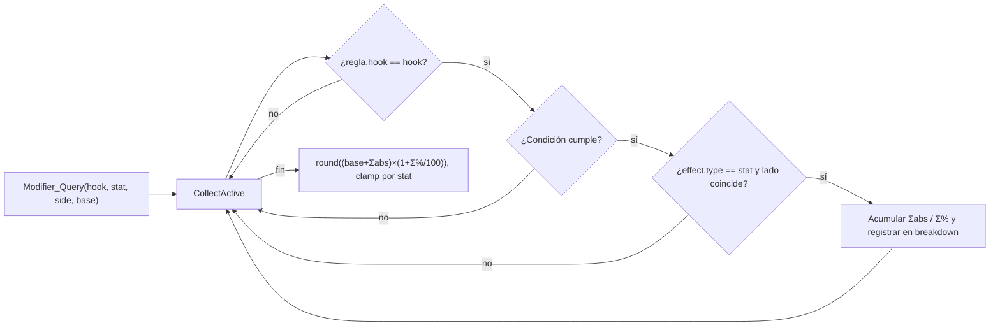
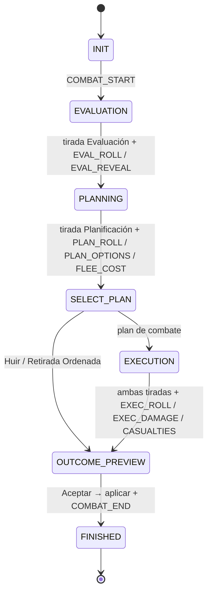
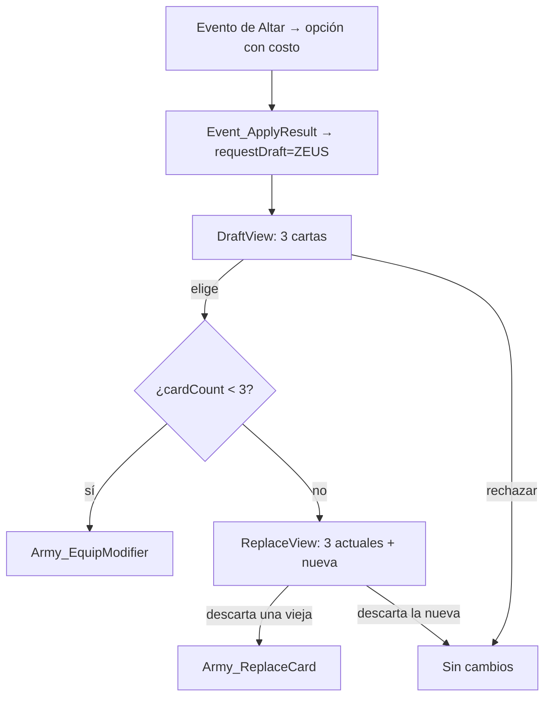
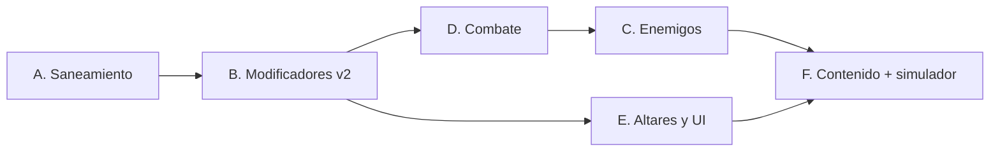

# Plan Técnico: Enemigos, Cartas Divinas, Maldiciones y Combate

> Documento de referencia para la implementación. Describe **qué** se cambia, **dónde**, **por qué** y **cómo se verifica**.
> Estado: decisiones de diseño D1–D7 **aprobadas**. Queda un único punto por confirmar: la calibración de la Ejecución (§2.1).

---

## Índice

1. [Diagnóstico del código actual](#1-diagnóstico-del-código-actual)
2. [Decisiones de diseño aprobadas](#2-decisiones-de-diseño-aprobadas)
3. [Convenciones de implementación](#3-convenciones-de-implementación)
4. [Fase A: Saneamiento](#4-fase-a--saneamiento)
5. [Fase B: Motor de Modificadores v2](#5-fase-b--motor-de-modificadores-v2)
6. [Fase C: Enemigos](#6-fase-c--enemigos)
7. [Fase D: Combate completo](#7-fase-d--combate-completo)
8. [Fase E: Altares, draft y UI de cartas/maldiciones](#8-fase-e--altares-draft-y-ui-de-cartasmaldiciones)
9. [Fase F: Contenido, debug y simulador](#9-fase-f--contenido-debug-y-simulador)
10. [Matriz de archivos afectados](#10-matriz-de-archivos-afectados)
11. [Orden de ejecución y criterios de cierre](#11-orden-de-ejecución-y-criterios-de-cierre)

---

## 1. Diagnóstico del código actual

### 1.1 Bugs críticos

| ID | Síntoma | Causa raíz | Archivo |
|----|---------|-----------|---------|
| **B1** | Ninguna carta tiene efecto | `GameMaster_Init` nunca llama a `Modifier_LoadAll`: el reemplazo automático buscaba un comentario que no existía. `modifierCount` queda en 0. | `src/controllers/game_master.c` |
| **B2** | El Rayo de Zeus (+3) no suma nada | En las tres fases de tirada, `Modifier_Apply(HOOK_*_ROLL, …, &ctx->xRoll)` se ejecuta **antes** de `ctx->xRoll = dice1 + dice2`, que pisa el valor modificado. | `src/models/combat.c` |
| **B3** | La pantalla de Resolución siempre muestra 0 bajas | Las bajas se calculan en `Combat_ApplyResolution`, que corre al apretar ESPACIO **después** de dibujar la pantalla. | `combat.c`, `combat_view.c` |
| **B4** | `casualties`/`moral` en hooks se ignoran; los efectos se aplican a cualquier valor | `Modifier_Apply` recibe un solo `int* refValue` y le suma todo efecto numérico de la regla sin verificar a qué estadística apunta. | `src/models/modifier.c` |
| **B5** | Una condición mal escrita se cumple siempre | Solo se reconoce `plan==FLEE`; cualquier otra cadena no filtra (*fail-open*). | `src/models/modifier.c` |

### 1.2 Bugs importantes

| ID | Problema | Archivo |
|----|----------|---------|
| **B6** | **Regresión:** se eliminó la advertencia por `gold:-50%`. La validación pasó a ser global cuando debe depender del contexto (evento vs. modificador). | `src/models/effect.c` |
| **B7** | `TextFormat("#%d", cardId)` recibe un `const char*`: comportamiento indefinido. | `src/views/hud.c` |
| **B8** | Los enemigos se dibujan a través de la niebla de guerra, en contra del GDD §3.2. | `src/views/enemy_view.c` |
| **B9** | El enemigo sigue activo tras el combate; al huir quedás en su casilla. | `main.c`, `combat.c` |
| **B10** | No se respeta el límite de 3 slots. Cartas y maldiciones comparten `activeModifiers[16]` y `Duration` no tiene contador. | `general.h` |
| **B11** | `Event_ApplyResult` ignora `cattle`, `addmod`, `removemod` y `drawmod`, así que un evento no puede dar cartas ni maldiciones. | `src/models/event.c` |
| **B12** | Nunca se invocan los hooks de mapa (`MAP_BASE_PA`, `MAP_VISION`, …): Hermes y el Cíclope no tienen efecto. | `game_master.c`, `main.c` |
| **B13** | Matemática de combate incompleta:<br>• las tiradas ignoran los stats<br>• Planificación no habilita planes<br>• solo el jugador recibe daño<br>• no hay victoria ni derrota<br>• el botín es siempre 0<br>• el costo de huir no depende de la tirada<br>• `fleeCostMorale` nunca se aplica | `combat.c` |
| **B14** | Hay un `ParseEffectType` duplicado y sin uso en `event.c`, y "daño" con ñ no se renderiza con la fuente por defecto. | `event.c`, `combat_view.c` |

### 1.3 Problemas de arquitectura
- **`models/` depende de `controllers/`:** `modifier.c` incluye `controllers/game_master.h` y `CombatContext` guarda un `GameMaster*`. Esto rompe el MVC e impide testear los modelos sin el juego completo.
- **`EnemySquad.name` es un `const char*`** que apunta a memoria ajena (`EventResult.battleEnemy` o literales). Es un riesgo de puntero colgante.
- **`baseStrength` del enemigo duplica información:** la fuerza debería derivarse de su composición, igual que en el ejército.
- **Combate de un evento:** usa un `static EnemySquad dummyEnemy` en `main.c`.

---

## 2. Decisiones de diseño aprobadas

| ID | Decisión |
|----|----------|
| **D1** | **Propiedad de los modificadores:**<br>• **Cartas** → Comandante. El General tiene 3 slots; el Teniente, 1 carta patrona dormida mientras es leal.<br>• **Maldiciones** → según `Target`: `COMMANDER` viaja con la persona; `ARMY` queda en el ejército aunque haya traición.<br>• **Rasgos de enemigo** → el escuadrón, con el mismo formato `.mod`. |
| **D2** | **Duraciones:** `PERMANENT`, `BATTLES:N`, `DAYS:N`. Cada modificador equipado guarda `{id, restante}`. |
| **D3** | **Apilamiento:** `final = round((base + Σabsolutos) × (1 + Σporcentajes/100))`, después un clamp por estadística. Dos +50% dan ×2, no ×2.25. |
| **D4** | **Combate:** un único intercambio en el que tiran ambos lados. El margen define las bajas de los dos (en peso 1/5/10). El enemigo queda derrotado si pierde ≥50% de su peso. *(Ver la calibración en §2.1.)* |
| **D5** | **Evaluación:** `2d6 + Evaluación − Ocultación enemiga`. Niveles: `<7` rangos, `7–9` composición exacta, `≥10` tags. |
| **D6** | **Planificación:** `2d6 + Planificación` habilita planes según una tabla de requisitos. Huir siempre está disponible. El Flanqueo da +3 si el enemigo tiene `Flanco expuesto` y −2 si no. |
| **D7** | **Enemigos en el mapa:** comportamientos `STATIC`, `PATROL` y `HUNT`. La infamia aumenta los `HUNT`. Si un enemigo entra en tu casilla, te embosca: −2 a Evaluación. |
| *(previas)* | La huida siempre es posible, con costo variable según la tirada.<br>El desborde de bajas convierte por peso (1 iniciado = 1, 1 soldado = 5, 1 sargento = 10).<br>Una carta duplicada no mejora: se reemplaza o se descarta.<br>Los altares se modelan como eventos. |

### 2.1 ⚠ Calibración de la Ejecución (único punto a confirmar)

Al calcular con las fórmulas reales de `army.c` y el ejército inicial de `main.c` (8 sargentos, 40 soldados, 15 iniciados, General con Ejecución 5) se obtiene:

| Stat | Valor | Comentario |
|------|-------|-----------|
| Ejecución (fuerza) | **≈ 40.9** | `5 + 8×1.5 + 40/2 + 15×0.6×e^(−15/18)` |
| Evaluación | ≈ 5.4 | Escala compatible con 2d6 ✔ |
| Planificación | ≈ 3.6 | Escala compatible con 2d6 ✔ |
| Movilidad | ≈ 2.4 | `liderazgo 3 − ganado 12×0.05` |
| Peso total | 295 | `15×1 + 40×5 + 8×10` |

**Problema:** si D4 se aplica literalmente (`2d6 + Ejecución`), la fuerza (~41) aplasta al dado (2–12). Contra una Patrulla Real (fuerza ≈ 15) el margen ronda +26 en todos los combates, así que el dado, los planes (+3/−2) y el Rayo de Zeus (+3) son irrelevantes. Es lo opuesto al problema del D12 plano que querías evitar.

**Propuesta, que mantiene la estructura de D4:** reemplazar el término "Ejecución" por la **Ventaja de Fuerza**, una cifra logarítmica de la relación entre fuerzas:

```
VentajaFuerza = clamp( round( 4 × log2(F_jugador / F_enemigo) ), −8, +8 )
```

| Relación de fuerzas | Ventaja |
|---|---|
| 1 : 1 | 0 |
| 1.5 : 1 | +2 |
| 2 : 1 | +4 |
| 3 : 1 | +6 |
| ≥ 4 : 1 | +8 (tope) |

Así la fuerza **desplaza la distribución** sin anularla:
- Un ejército el doble de grande gana ~85% de las veces, no el 100%.
- Las cartas (+3) y los planes (+3/−2) siguen valiendo lo mismo que el dado.

Las constantes (`4`, `±8`) viven en `combat_balance.h` (§3) y se ajustan con el simulador (§9.3).

> **Hasta tu confirmación, la Fase D se implementa con esta fórmula.** Si preferís otra, solo cambia una función: `Combat_ForceAdvantage`.

---

## 3. Convenciones de implementación

1. **Sin ediciones de C por regex de PowerShell.** Ediciones directas sobre el archivo, verificación del resultado y compilación después de cada módulo.
2. **`models/` es puro:** no incluye `raylib.h`, `controllers/` ni `views/`. El azar entra por parámetro (dados ya tirados o un puntero a función RNG).
3. **Validación *fail-closed* con ubicación:** toda clave o token inválido en datos produce `WARNING [archivo:línea]: … Token 'X'.` y descarta la unidad afectada (regla, efecto, plantilla, evento). Nunca se aplica "por defecto".
4. **Constantes de balance centralizadas** en `include/models/combat_balance.h`, sin números mágicos dispersos.
5. **Las vistas no mutan estado:** devuelven *intenciones* (`CombatUiAction`, `DraftUiAction`) y un controller las aplica a los modelos.

---

## 4. Fase A: Saneamiento

Objetivo: dejar funcionando lo que ya existe, sin agregar features.

| Bug | Cambio |
|-----|--------|
| B1 | En `GameMaster_Init`: `gm->modifierCount = Modifier_LoadAll("assets/modifiers", gm->modifiers, MAX_MODIFIERS);` y un log `[MOD] N cargados: id1, id2…`. Inicializar explícitamente `inCombat = false` y `enemyCount = 0`. |
| B2 | Reordenar: primero `roll = d1 + d2`, después el hook sobre el valor ya tirado. |
| B3 | Separar `Combat_ComputeOutcome` (al final de la Ejecución, guarda la vista previa en el contexto) de `Combat_ApplyOutcome` (al confirmar). |
| B7 | La HUD dibuja la inicial del `Source` (Z/A/H/…) buscando el `ModifierDef` por id. |
| B9 | Interino hasta la Fase D:<br>• victoria → `enemy->isActive = false`<br>• huida → el ejército vuelve a `previousPosition` (nuevo campo en `Army`, que se setea antes de cada paso) |
| B14 | Borrar el `ParseEffectType` duplicado de `event.c`; reemplazar "ñ" por "n" en los textos de combate hasta tener una fuente con glifos (§7.8). |

**Criterio de cierre**
- Compila sin warnings nuevos.
- La consola lista los 5 `.mod`.
- Un combate muestra bajas reales en la Resolución.
- Al ganar, el estandarte desaparece.

---

## 5. Fase B: Motor de Modificadores v2

### 5.1 Registro desacoplado del GameMaster

```c
/* include/models/modifier.h */
typedef struct {
    ModifierDef defs[MAX_MODIFIERS];
    int count;
} ModifierRegistry;
```
- `GameMaster` contiene un `ModifierRegistry modRegistry` en lugar de `modifiers[]` + `modifierCount`.
- Todo modelo recibe `const ModifierRegistry*` y nunca un `GameMaster*`. Esto **elimina la dependencia models→controllers** (§1.3).

### 5.2 Metadatos ampliados de `ModifierDef`

```c
typedef enum { MOD_TARGET_COMMANDER = 0, MOD_TARGET_ARMY, MOD_TARGET_ENEMY } ModifierTarget;
typedef enum { DURATION_PERMANENT = 0, DURATION_BATTLES, DURATION_DAYS } DurationType;

typedef struct {
    char id[32];
    char name[64];
    char description[160];       /* NUEVO: clave Description= (texto para UI) */
    ModifierKind kind;           /* CARD, CURSE, TRAIT */
    ModifierTarget target;       /* NUEVO: parseado (antes string libre) */
    char source[32];             /* ZEUS, HERMES… */
    int  rarityWeight;           /* NUEVO: COMMON=60, RARE=30, EPIC=10 */
    char tags[8][16];            /* NUEVO: lista parseada (antes string crudo) */
    int  tagCount;
    DurationType durationType;   /* NUEVO */
    int  durationValue;          /* N de BATTLES:N / DAYS:N */
    ModifierRule rules[MAX_RULES_PER_MODIFIER];
    int  ruleCount;
} ModifierDef;
```

Reglas de carga:
- `Kind=CARD` sin `Source` → warning, se descarta el modificador.
- `Duration` inválida (`BATTLE:5`, `DAYS:x`) → warning, se descarta.
- Las cartas son `PERMANENT` por defecto; una maldición sin `Duration` es `PERMANENT`.
- `Target` por defecto: `CARD` → `COMMANDER`, `CURSE` → `ARMY`, `TRAIT` → `ENEMY`.
- Un `Id` duplicado entre archivos produce un warning y se queda el primero.

### 5.3 Instancias equipadas (D1 + D2)

```c
/* include/models/modifier.h */
typedef struct {
    char id[32];
    int  remaining;   /* -1 = permanente; N = batallas o días restantes */
} ModifierInstance;
```

| Dueño | Campo nuevo | Reemplaza a |
|-------|-------------|-------------|
| `General` | `ModifierInstance cards[3]; int cardCount;`<br>`ModifierInstance curses[4]; int curseCount;` | `activeModifiers[16]` |
| `Lieutenant` | `ModifierInstance patronCard; bool hasPatronCard;`<br>`ModifierInstance curses[4]; int curseCount;` | `activeModifiers[16]` |
| `Army` | `ModifierInstance curses[8]; int curseCount;` | — |
| `EnemySquad` | `ModifierInstance traits[4]; int traitCount;` | — |

`Lieutenant_Create` recibe un parámetro nuevo, `const char* patronCardId`. Cada teniente tiene dios patrono fijo, que sirve de presagio en la UI (§8.4).

**API de equipamiento** (`models/army.c`, pura):
```c
typedef enum { EQUIP_OK, EQUIP_SLOTS_FULL, EQUIP_DUPLICATE, EQUIP_INVALID } EquipResult;

EquipResult Army_EquipModifier(Army* army, const ModifierDef* def);   /* enruta por kind/target */
bool        Army_ReplaceCard(Army* army, int slot, const ModifierDef* def);
bool        Army_RemoveModifier(Army* army, const char* id);
void        Army_TickModifiers(Army* army, DurationType type);         /* −1 y retira los que llegan a 0 */
bool        Army_HasModifier(const Army* army, const char* id);
```
- Una carta repetida devuelve `EQUIP_DUPLICATE` (no mejora). Igual el draft nunca ofrece cartas que ya tenés.
- Con 3 cartas, `EQUIP_SLOTS_FULL` → el controller abre la pantalla de reemplazo (§8.2).
- **Traición:** no hace falta código especial. La recolección (§5.4) toma las cartas del comandante *actual*, así que al asumir el Teniente se activa su carta patrona y las del General quedan dormidas. Las maldiciones `ARMY` persisten.

### 5.4 Recolección de modificadores activos

```c
typedef enum { SIDE_PLAYER = 0, SIDE_ENEMY } ModSide;

typedef struct {
    const ModifierDef* def;
    ModSide owner;
} ActiveMod;

int Modifier_CollectActive(const ModifierRegistry* reg, const Army* army,
                           const EnemySquad* enemy, ActiveMod* out, int max);
```
Orden de recolección:
1. Cartas del comandante actual.
2. Maldiciones del comandante.
3. Maldiciones del ejército.
4. Rasgos del enemigo, si hay combate.
5. **Rasgos implícitos por tag:** cada tag del enemigo se mapea a un `.mod` de sistema (`tag_cavalry.mod`, …). Las mecánicas de tags quedan en datos (§7.5).

### 5.5 Lados de un efecto: prefijo `enemy.`

Las estadísticas se dividen en dos clases:

| Clase | Estadísticas | Semántica |
|-------|--------------|-----------|
| **Con lado** | `evaluation`, `planning`, `execution`, `casualties` | Sin prefijo afectan al **lado del dueño**; con `enemy.` afectan al **lado contrario**. |
| **De contexto** | `flee_cost`, `pa`, `move_cost`, `vision`, `food`, `water`, `moral`, `gold`, `cattle`, `infamy` | Siempre afectan al jugador. El prefijo `enemy.` es inválido (warning). |

Ejemplos:
- `Effect=enemy.execution:-2`: una carta que debilita al rival.
- `Effect=casualties:-30%`, en una carta: reduce **tus** bajas.
- `Effect=casualties:-30%`, en un rasgo de enemigo: reduce **sus** bajas (enemigo acorazado).
- `Effect=flee_cost:+50%`, en un rasgo de caballería: encarece **tu** huida.

`EffectDef` agrega `ModSide side` (`SIDE_SELF` / `SIDE_OPPONENT`, relativo al dueño).

> **Migración de datos:** `ares_marea_roja.mod` pasa de `casualties:+50%` a `enemy.casualties:+50%`, que es lo que significaba "más daño causado".

### 5.6 Consulta tipada con desglose (reemplaza a `Modifier_Apply`)

```c
typedef struct {
    char source[48];      /* "Rayo de Zeus", "Maldición del Cíclope", "Plan: Flanqueo" */
    int  flat;            /* aporte absoluto */
    int  percent;         /* aporte porcentual */
} ModBreakdownEntry;

typedef struct {
    int base;
    ModBreakdownEntry entries[12];
    int count;
    int final;
} ModBreakdown;

typedef struct {
    const ModifierRegistry* reg;
    const Army*             army;
    const EnemySquad*       enemy;    /* NULL fuera de combate */
    const struct CombatContext* combat; /* NULL fuera de combate */
    int timeOfDay;
    float infamy;
} ModContext;

int Modifier_Query(ModifierHook hook, EffectType stat, ModSide side,
                   const ModContext* ctx, int base, ModBreakdown* outOpt);
```



**Clamps por estadística:**
- Los costos (`flee_cost`, `move_cost`) nunca bajan de 0, y `move_cost` nunca baja de 1.
- `pa` y `vision` tienen un mínimo de 1.
- Σ% se limita a un piso de −100%.

El desglose es lo que permite que la UI muestre `2d6 (4+3) + Evaluación 5 − Ocultación 4 + Ojo de Atenea 2 = 10`. Esto cumple el pilar de que toda decisión va acompañada de una estadística visible.

### 5.7 Acciones no numéricas

Los efectos que no transforman un número se recolectan y los aplica el **controller**:

```c
typedef struct {
    EffectType type;        /* UNLOCK_PLAN, ADD_MOD, REMOVE_MOD, DRAW_MOD, MORAL, GOLD… */
    char arg[32];           /* id de plan / modificador / dios */
    int  value;
    const ModifierDef* source;
} ModAction;

int Modifier_CollectActions(ModifierHook hook, const ModContext* ctx, ModAction* out, int max);
```

### 5.8 Mini-lenguaje de condiciones

Gramática, parseada **al cargar** el `.mod`:
```
condición := término ( "AND" término )*
término   := lhs op valor
           | func "(" ARG ")" [ op entero ]
lhs       := plan | moral | infamy | time | eval_tier | origin
func      := enemy_tag | known_tag | equipped_tag
op        := == | != | >= | <= | > | <
```

| Término | Significado | Ejemplo |
|---------|-------------|---------|
| `plan==X` | Plan elegido | `plan==FLEE` |
| `enemy_tag(X)` | El enemigo **realmente** tiene el tag (apuesta) | `enemy_tag(CAVALRY)` |
| `known_tag(X)` | El jugador **reveló** el tag | `known_tag(EXPOSED_FLANK)` |
| `equipped_tag(X)>=N` | Cartas equipadas con ese tag (sinergias) | `equipped_tag(FLEE)>=2` |
| `moral<N`, `infamy>=N` | Estado del ejército / mundo | `infamy>=50` |
| `time==NIGHT` | Momento del día | |
| `eval_tier>=N` | Nivel de información (0/1/2) | |
| `origin==AMBUSHED` | Cómo empezó el combate | |

```c
typedef enum { COND_PLAN, COND_ENEMY_TAG, COND_KNOWN_TAG, COND_EQUIPPED_TAG,
               COND_MORAL, COND_INFAMY, COND_TIME, COND_EVAL_TIER, COND_ORIGIN } CondLhs;
typedef enum { OP_EQ, OP_NE, OP_GE, OP_LE, OP_GT, OP_LT } CondOp;

typedef struct { CondLhs lhs; char arg[16]; CondOp op; int rhsInt; char rhsStr[24]; } CondTerm;
typedef struct { CondTerm terms[4]; int termCount; } Condition;  /* reemplaza char condition[64] */
```
Cualquier error de parseo da `WARNING [hermes.mod:12]: Condición inválida 'plan=FLEE' (token '='). Regla descartada.` (corrige B5).

### 5.9 Validación por contexto (corrige B6)

`Effect_ParseString` solo parsea. La validación la hace cada cargador:

| Contexto | Stats permitidas | `%` | `ALL` | `enemy.` |
|----------|------------------|-----|-------|----------|
| `.res` (eventos) | gold, infamy, moral, food, water, initiates, soldiers, sergeants, cattle, addmod, removemod, drawmod | solo tropas | solo tropas | ✗ |
| `.mod` (modificadores) | según el hook (tabla siguiente) | ✔ | ✗ | solo stats con lado |

**Compatibilidad hook ↔ estadística** (en `.mod`; una combinación inválida da warning y se descarta el efecto):

| Hook | Stats válidas |
|------|---------------|
| `PASSIVE` | evaluation, planning, execution, vision |
| `COMBAT_START` | moral (acción) |
| `EVAL_ROLL` | evaluation |
| `EVAL_REVEAL` | *(acciones futuras: revelar tag)* |
| `PLAN_ROLL` | planning |
| `PLAN_OPTIONS` | unlock_plan |
| `FLEE_COST` | flee_cost |
| `EXEC_ROLL` | execution |
| `EXEC_DAMAGE` | casualties |
| `CASUALTIES` | moral (acción) |
| `COMBAT_END` | moral, gold, food, cattle, infamy, addmod, removemod |
| `MAP_BASE_PA` | pa |
| `MAP_MOVE_COST` | move_cost |
| `MAP_VISION` | vision |
| `DAILY_CONSUMPTION` | food, water (modifican el *consumo*) |
| `NIGHT_FALL` | moral, vision |
| `EVENT_RESULT` | gold, food, water, moral, infamy |

> **Migración de datos:** `atenea_retirada.mod` mueve `casualties:-30%` de `CASUALTIES` a `EXEC_DAMAGE`, que es donde se modifica el peso de bajas.

`EffectType` agrega: `EFFECT_EVALUATION`, `EFFECT_PLANNING`, `EFFECT_MOVE_COST`.

### 5.10 Hooks de mapa conectados (corrige B12)

| Punto del juego | Cambio |
|-----------------|--------|
| `GameMaster_ApplyDiceRoll` | `PA = Query(MAP_BASE_PA, pa, base=baseActionPoints) + dados`. La firma pasa a recibir `const Army*`. |
| Visión | Nueva función `GameMaster_GetArmyVision(gm, army)` = `Query(MAP_VISION, vision, Army_GetVision + modificador nocturno)`. Reemplaza las ~4 apariciones de `Army_GetVision(...) + GameMaster_GetVisionModifier(...)` en `main.c`. |
| Costo de movimiento | `GameMaster_AttemptMove` usa `Query(MAP_MOVE_COST, move_cost, biomeCost)`. Para que la flecha muestre el mismo costo, `Map_FindPathEx(map, start, end, costFn, userData, …)` recibe un callback de costo y `Map_FindPath` queda como wrapper. |
| Consumo | El consumo por paso pasa por `Query(DAILY_CONSUMPTION, food/water, …)`. |
| Anochecer | En `GameMaster_EndTurn`, al pasar a `TIME_NIGHT`: `CollectActions(NIGHT_FALL)`. |
| Nuevo día | `Army_TickModifiers(army, DURATION_DAYS)`. |

### 5.11 `Event_ApplyResult` ampliado (corrige B11)

```c
typedef struct {
    bool requestDraft;
    char draftSource[32];      /* "ZEUS", "ANY" */
    bool requestBattle;
    char battleTemplate[32];
    char warnings[2][96];      /* p.ej. "Slots llenos: X no equipada" */
} EventApplyOutput;

void Event_ApplyResult(const EventResult* res, Army* army, float* infamy,
                       const ModifierRegistry* reg, EventApplyOutput* out);
```
- `cattle:±N`: aplica sobre `ganado`.
- `addmod:curse_cyclops`: `Army_EquipModifier`. Una carta con slots llenos abre el reemplazo.
- `removemod:curse_cyclops`: `Army_RemoveModifier` (purificación en un templo, por ejemplo).
- `drawmod:ZEUS` / `drawmod:ANY`: `out->requestDraft`, y el controller abre el draft (§8).

**Criterio de cierre de la Fase B**
- Los 5 `.mod` cargan sin warnings.
- Un `.mod` de prueba con errores produce los warnings esperados (condición, hook↔stat, `enemy.` inválido).
- Hermes da +1 PA visible en la HUD.
- El Cíclope reduce la visión en el mapa.
- Un `.res` con `addmod:` equipa la maldición.

---

## 6. Fase C: Enemigos

### 6.1 Plantillas de datos: `assets/enemies/*.enm`

```ini
[ENEMY]
Id=patrulla_real
Name=Patrulla Real
Sergeants=2
Soldiers=10
Initiates=10
Execution=4            ; equivalente a la Ejecución del comandante
Concealment=4          ; resta a tu Evaluación
Mobility=3             ; MISMA escala que Army_CalculateMobility (~1–6)
Vision=3
Tags=CAVALRY, HEAVILY_ARMORED
Traits=                ; ids de .mod con Kind=TRAIT (opcional)
Behavior=HUNT
Loot=gold:30-60, food:20-40, cattle:0-3

[SPAWN]
Biome=PLAINS, FOREST
MinDay=2
MinInfamy=20
Weight=3
```
- La validación es igual que en eventos: tag, biome o behavior inválido → warning y se descarta la plantilla.
- Un `Traits` con un id que no existe en el registro produce un warning y se omite ese rasgo.

> ⚠ La movilidad de los enemigos de prueba (10–12) está en otra escala que la del jugador (≈2.4). Con esto queda unificada.

### 6.2 Modelo

```c
typedef enum { BEHAVIOR_STATIC = 0, BEHAVIOR_PATROL, BEHAVIOR_HUNT } EnemyBehavior;
typedef struct { int min, max; } IntRange;

typedef struct {                       /* Plantilla (datos) */
    char id[32], name[48];
    int  sergeants, soldiers, initiates;
    int  execution, concealment, mobility, vision;
    unsigned int tags;
    char traits[4][32]; int traitCount;
    EnemyBehavior behavior;
    IntRange lootGold, lootFood, lootCattle;
    bool biomes[6]; bool hasBiomeKey;
    int  minDay; float minInfamy; int weight;
} EnemyTemplate;

typedef struct {                       /* Instancia (en el mapa) */
    const EnemyTemplate* tpl;
    char name[48];                     /* copia propia: sin punteros colgantes */
    HexCoord position, patrolTarget, lastSeenPlayer;
    int  sergeants, soldiers, initiates;   /* se reducen con las bajas */
    int  initialWeight;                    /* para la regla de ≥50% */
    unsigned int tags, knownTags;
    int  knowledgeTier;                    /* mejor nivel de Evaluación obtenido (persiste) */
    ModifierInstance traits[4]; int traitCount;
    EnemyBehavior behavior;
    bool isActive, hasSeenPlayer, isTemporary;
} EnemySquad;
```
- **Se elimina `baseStrength`.** La fuerza se deriva de la composición con una función compartida:
  ```c
  float Troops_CalculateExecution(int commanderExec, int sgt, int sol, int ini, float B);
  ```
  `Army_CalculateExecution` pasa a usarla internamente, así las dos fórmulas no se desincronizan.
- **`knowledgeTier` persiste:** si huís y volvés, conservás lo que ya sabías del escuadrón.

### 6.3 Spawner (reemplaza a `GameMaster_SpawnTestEnemies`)

`GameMaster_SpawnEnemies(gm, map, playerPos)`:
- **Al iniciar el nivel:** `N = 4 + floor(infamia / 25)`, con tope `MAX_ACTIVE_ENEMIES = 16`.
- **Cada amanecer:** probabilidad `30% + infamia/2 %` de un spawn extra.
- **Casillas candidatas:**
  - tierra (no agua)
  - sin estructura
  - sin otro enemigo
  - a distancia ≥ 4 del jugador
  - **fuera de su visión actual**
- **Plantilla:** sorteo ponderado por `Weight` entre las que cumplen bioma, `MinDay` y `MinInfamy`.
- **Infamia → caza:** si la infamia es ≥ 50, cada `PATROL` tiene `(infamia − 50)%` de chance de spawnear como `HUNT`.

### 6.4 IA (`GameMaster_ProcessEnemyTurn`)

Presupuesto por turno: `AP = mobility × 2`, con costo de bioma vía `Map_FindPathEx`.

| Comportamiento | Lógica |
|----------------|--------|
| `STATIC` | No se mueve. Combate solo si el jugador entra en su casilla. |
| `PATROL` | Elige un `patrolTarget` (casilla de camino a ≤ 6 hexes; si no hay caminos, tierra al azar) y avanza. Al llegar, elige otro. Si ve al jugador a ≤ 2 hexes, lo ataca. |
| `HUNT` | Si el jugador está dentro de su visión (−1 de noche): `hasSeenPlayer = true`, guarda `lastSeenPlayer` y avanza hacia él. Si lo pierde, va a la última posición conocida y después patrulla. |

Reglas comunes:
- Los enemigos no pisan casillas de otros enemigos.
- Si un enemigo **entra en la casilla del jugador**, se detiene y empieza un combate con `origin = AMBUSHED` (D7: −2 a Evaluación).
- Por ahora el movimiento es instantáneo; la animación por casillas queda opcional (§9).

### 6.5 Integración con el movimiento del jugador
- **A\*:** las casillas con enemigos activos son **intransitables**, salvo si son el destino. La ruta ya no puede atravesar un escuadrón.
- **`GameMaster_AttemptMove`:** si la casilla destino tiene un enemigo, no se tira evento y empieza un combate con `origin = PLAYER_ATTACK`.
- **Combate desde evento:** `Result_Battle=patrulla_real` pasa a ser un **id de plantilla**. Se crea un escuadrón `isTemporary` en tu posición, que al terminar se libera. Así se elimina el `static dummyEnemy` de `main.c`.
- **Punto de entrada único:**
  ```c
  void GameMaster_StartCombat(GameMaster* gm, Army* army, EnemySquad* enemy, CombatOrigin origin);
  ```

### 6.6 Vista (`enemy_view.c`)

- **Niebla de guerra (corrige B8):** se dibuja solo si `tile->visible || debugRevealMap`.
- **Altura:** se aplica el offset de altura del bioma. Se exporta `MapView_GetTileTopOffset(biome)`, hoy `GetBiomeHeight` es estático.
- **Marcador:** color según comportamiento (STATIC gris, PATROL bordo, HUNT rojo intenso) e inicial del nombre.
- **Tooltip** (en espacio de pantalla, al pasar el mouse), según `knowledgeTier`:
  - Nivel 0: nombre + "Fuerza: 10–35" (rango determinista, ±40% redondeado a 5)
  - Nivel 1: composición exacta
  - Nivel 2: composición + tags
- **Flecha de ruta:** si el destino es un enemigo, se vuelve roja, termina en un ícono de espadas cruzadas y la burbuja dice "Atacar".

**Criterio de cierre de la Fase C**
- Al iniciar aparecen N enemigos según la infamia, ninguno visible desde el inicio.
- Un `HUNT` persigue al jugador cuando lo ve.
- Si un enemigo pisa tu casilla, el combate empieza en modo emboscada.
- La ruta no atraviesa escuadrones.
- Los enemigos no se ven en la niebla.

---

## 7. Fase D: Combate completo

### 7.1 Máquina de estados



### 7.2 Contexto

```c
typedef enum { ORIGIN_PLAYER_ATTACK = 0, ORIGIN_AMBUSHED, ORIGIN_EVENT } CombatOrigin;
typedef enum { INFO_TIER_RANGE = 0, INFO_TIER_COMPOSITION, INFO_TIER_FULL } InfoTier;
typedef enum { OUTCOME_NONE = 0, OUTCOME_DECISIVE_VICTORY, OUTCOME_NARROW_VICTORY,
               OUTCOME_STALEMATE, OUTCOME_DEFEAT, OUTCOME_FLED, OUTCOME_ANNIHILATED } CombatOutcome;

typedef struct { int dice[2]; int statBonus; ModBreakdown mods; int total; } RollResult;
typedef struct { int initiates, soldiers, sergeants; } Casualties;
typedef struct { int food, cattle, morale, rearguardWeight; } FleeCost;

typedef struct CombatContext {
    CombatState  state;
    CombatOrigin origin;
    const ModifierRegistry* reg;      /* reemplaza GameMaster* */
    Army*        army;
    EnemySquad*  enemy;

    RollResult   evalRoll, planRoll, execPlayer, execEnemy;
    InfoTier     infoTier;
    unsigned int availablePlans;      /* bitmask (1 << CombatPlan) */
    CombatPlan   selectedPlan;
    FleeCost     fleeCost;
    int          forceAdvantage;
    int          margin;

    int          damageToPlayer, damageToEnemy;   /* en peso */
    Casualties   playerLosses, enemyLosses;
    int          lootGold, lootFood, lootCattle;
    float        moraleDelta, infamyDelta;
    CombatOutcome outcome;

    char log[16][96]; int logCount;   /* registro legible para la vista */
} CombatContext;
```

### 7.3 Evaluación (D5)

```
total = 2d6 + (int)Evaluación(ejército)
      + Query(EVAL_ROLL, evaluation, SIDE_PLAYER)
      − Ocultación(enemigo)
      − (origin == AMBUSHED ? 2 : 0)
```

| Total | Nivel | Qué se ve |
|-------|-------|-----------|
| < 7 | `RANGE` | "Fuerza: 10–35", composición oculta |
| 7–9 | `COMPOSITION` | Sargentos/soldados/iniciados exactos |
| ≥ 10 | `FULL` | Todo lo anterior + **tags** (se revelan con `Enemy_RevealTags`) |

`enemy->knowledgeTier = max(previo, nivel)`. Después corre `CollectActions(EVAL_REVEAL)`.

Referencia con el ejército inicial contra la Patrulla Real (Ocultación 4): el promedio es 7 + 5 − 4 = 8 (composición), y `FULL` sale ~28% de las veces.

### 7.4 Planificación y tabla de planes (D6)

```
total = 2d6 + (int)Planificación(ejército) + Query(PLAN_ROLL, planning, SIDE_PLAYER)
```

| Plan | Requisito | Efecto | Notas |
|------|-----------|--------|-------|
| **Huir** | siempre | Costo según §7.6 | No hay Ejecución |
| **Asalto Frontal** | siempre | — | |
| **Formación Defensiva** | total ≥ `PLAN_DEF_MIN` (6) | Tus bajas −30%, las del enemigo −30%; **+2 contra `CAVALRY`** | |
| **Flanqueo** | total ≥ `PLAN_FLANK_MIN` (9) | **+3** si el enemigo tiene `EXPOSED_FLANK`, **−2** si no | La UI muestra "+3", "−2" o "+3 / −2 ?" según lo revelado |
| **Contraemboscada** | `known_tag(AMBUSH)` | Anula el −2 por emboscada; +2 a Ejecución | |
| **Retirada Ordenada** | solo por `unlock_plan` (Atenea) | Huida con severidad ÷2 | |

> Calibración: con Planificación ≈ 3.6, el umbral 6 sale casi siempre y el 9 ~72%. Los umbrales viven en `combat_balance.h`. Si con el simulador resultan demasiado generosos, la propuesta es pasar a 8/11.

Después corre `CollectActions(PLAN_OPTIONS)`, que procesa los `unlock_plan:X` y los suma a `availablePlans`.

### 7.5 Tags como rasgos de datos

Cada tag tiene un `.mod` de sistema en `assets/modifiers/system/`, que se aplica automáticamente al enemigo que lo posee:

| Tag | Archivo | Reglas |
|-----|---------|--------|
| `CAVALRY` | `tag_cavalry.mod` | `FLEE_COST: flee_cost:+50%` · `EXEC_ROLL: execution:+1` |
| `HEAVILY_ARMORED` | `tag_armored.mod` | `EXEC_DAMAGE: casualties:-20%` (bajas propias del enemigo) |
| `DISORGANIZED` | `tag_disorganized.mod` | `EXEC_ROLL: execution:-2` |
| `AMBUSH` | `tag_ambush.mod` | `EXEC_ROLL: execution:+2` · `Condition=origin==AMBUSHED` |
| `EXPOSED_FLANK` | *(sin reglas propias; lo consulta el Flanqueo)* | |

Así **toda** la mecánica de tags queda editable sin recompilar.

### 7.6 Costo de huida

```
presión    = Movilidad(enemigo) − Movilidad(ejército)
severidad  = clamp( 2·presión + FLEE_BASE − totalPlanificación, 0, 12 )      ; FLEE_BASE = 12
```

| Componente | Fórmula base | Hook |
|------------|--------------|------|
| Comida | `round(comida × 0.02 × severidad)` | `FLEE_COST` (`flee_cost` % se aplica a todos los componentes) |
| Ganado | `round(ganado × 0.04 × severidad)` | ídem |
| Moral | `severidad × 1.0` | ídem |
| Retaguardia | `severidad ≥ 6 ? severidad × 3 : 0` (peso, con reparto por desborde) | ídem |

- Con severidad 0 la huida es limpia.
- Hermes (`flee_cost:-100%`) la deja gratis.
- La caballería (+50%) la encarece.
- Se muestra con desglose **antes** de elegir.

### 7.7 Ejecución y resultado (D4 + §2.1)

```
VentajaFuerza = clamp(round(4·log2(F_jug / F_ene)), −8, +8)

P = 2d6 + VentajaFuerza + bonoPlan + Query(EXEC_ROLL, execution, SIDE_PLAYER)
E = 2d6                 + Query(EXEC_ROLL, execution, SIDE_ENEMY)
margen = P − E
```

**Bajas en porcentaje del peso propio:**
```
pérdidaJug = clamp(0.20 − 0.04·margen, 0.03, 0.80)
pérdidaEne = clamp(0.20 + 0.04·margen, 0.03, 0.80)
dañoAlJugador = round(pesoJug × pérdidaJug) → Query(EXEC_DAMAGE, casualties, SIDE_PLAYER)
dañoAlEnemigo = round(pesoEne × pérdidaEne) → Query(EXEC_DAMAGE, casualties, SIDE_ENEMY)
```

| Margen | Pérdida del jugador | Pérdida del enemigo |
|--------|---------------------|---------------------|
| −8 | 52% | 3% |
| −4 | 36% | 4% |
| 0 | 20% | 20% |
| +4 | 4% | 36% |
| +8 | 3% | 52% → derrota decisiva |

Los dos daños se reparten con la **regla de desborde** (iniciados → soldados ÷5 → sargentos ÷10), la misma función para ambos lados: `Troops_DistributeCasualties(int weight, int* ini, int* sol, int* sgt, Casualties* out)`. Después corre `CollectActions(CASUALTIES)`.

**Desenlace:**

| Condición | Resultado | Consecuencias |
|-----------|-----------|---------------|
| Tropas del jugador = 0 | `ANNIHILATED` | Game over |
| Enemigo perdió ≥ 50% de `initialWeight` | `DECISIVE_VICTORY` | Enemigo desactivado · botín 100% · moral +6 |
| margen > 0 | `NARROW_VICTORY` | El enemigo retrocede 2 hexes con sus bajas · botín 25% · moral +3 |
| margen = 0 | `STALEMATE` | Ambos con bajas · retrocedés 1 hex · moral −2 |
| margen < 0 | `DEFEAT` | Retrocedés 1 hex · moral −(5 + 2·|margen|) |
| Huida | `FLED` | Se aplica `fleeCost` · retrocedés 1 hex |

El botín se sortea dentro de los rangos `Loot` de la plantilla, con un RNG inyectado.

**Cierre (`Combat_ApplyOutcome`):**
1. Aplica bajas, botín, moral y posición.
2. Corre `CollectActions(COMBAT_END)`.
3. `Army_TickModifiers(army, DURATION_BATTLES)`.
4. Si `isTemporary`, libera el escuadrón.

**Referencia con números reales:** el ejército inicial (F ≈ 40.9) contra la Patrulla Real (F ≈ 15.4) da una ventaja de +6. Es muy favorable, así que las plantillas deben escalar con el día (§9.1).

### 7.8 Vista y controller

- **`controllers/combat_controller.c`** (nuevo): `CombatController_Update(gm, ctx, CombatUiAction)` tira los dados con `GetRandomValue` y llama a los modelos. La vista ya no llama funciones de `combat.c`.
- **`views/combat_view.c`:**
  - `CombatUiAction CombatView_DrawAndInput(const CombatContext*, CombatViewState*, SW, SH)`
  - **Dados animados** de ~0.6 s con caras aleatorias. Es solo animación: el resultado ya está en el modelo.
  - **Desglose de cada tirada** con el `ModBreakdown`: base, stat, cada carta y cada tag.
  - **Panel enemigo** según `infoTier`.
  - **Botones de plan** generados desde `availablePlans`, con su efecto esperado y el costo de huida desglosado.
  - **Pantalla de resultado** con bajas de ambos lados, botín, cambio de moral y el log.
- **Fuente con glifos en español:** `LoadFontEx` con los codepoints `áéíóúñÑ¿¡`, para toda la UI. Es opcional; si no, el texto queda sin tildes.

**Criterio de cierre de la Fase D**
- Cada tirada muestra un desglose que coincide con el cálculo.
- El Flanqueo a ciegas a veces da −2.
- Hermes deja la huida en 0.
- La caballería la encarece.
- Una victoria decisiva elimina al enemigo y da botín.
- Las maldiciones `BATTLES:N` descuentan.

---

## 8. Fase E: Altares, draft y UI de cartas/maldiciones

### 8.1 Draft (modelo)

```c
int Modifier_DrawFromPool(const ModifierRegistry* reg, const char* source /* "ZEUS" | "ANY" */,
                          const Army* army, int (*rng)(int, int),
                          const ModifierDef** out, int n /* 3 */);
```
- Solo entran `Kind=CARD` del dios pedido (o de todos con `ANY`), **sin incluir las que ya tenés** ni la carta patrona del comandante actual.
- Sorteo ponderado por rareza (60/30/10) y sin repetición.
- Si el pool tiene menos de 3 cartas, se ofrecen las que haya. Si no hay ninguna, se avisa.

### 8.2 Flujo (controller + vistas)



- `GameMaster` agrega `PendingDraft pendingDraft` y un estado `PHASE_DRAFT`, que bloquea el input del mapa igual que `PHASE_EVENT`.
- **DraftView:** tarjetas con nombre, dios, borde del color de la rareza, `Description` y la lista de reglas generada automáticamente si falta la descripción (por ejemplo "Al huir: costo −100%").

### 8.3 Altares como eventos (sin tipo de casilla nuevo)

```ini
; assets/events/altar_zeus.evt
[EVENT]
Id=altar_zeus
Name=Altar de Zeus
Description=Un altar ennegrecido por rayos. El dios exige tributo.
Trigger=RANDOM, ROAD
Probability=15
[OPTION_1]
Text=Ofrecer ganado
Result_pool=res_altar_zeus_ganado
[OPTION_2]
Text=Ofrecer sangre
Result_pool=res_altar_zeus_sangre
[OPTION_3]
Text=Seguir de largo
Result_pool=NONE
```
```ini
; assets/results/res_altar_zeus_ganado.res
[RESULT]
Id=res_altar_zeus_ganado
Name=El rayo acepta la ofrenda
Effect=cattle:-6
Effect=drawmod:ZEUS
```
Se respeta el principio de **riesgo vs. recompensa**: el costo está siempre explícito en la opción.

### 8.4 HUD

- **Slots de carta:** borde por rareza, inicial del dios y tooltip con nombre y descripción. Corrige B7.
- **Fila de maldiciones** bajo el panel del comandante: íconos violetas con el contador (`3B` = 3 batallas, `2D` = 2 días) y tooltip.
- **Presagio del teniente:** en el panel expandido, "Publio Varro — patrono: Ares (Marea Roja) · dormida". Te dice qué teniente sería más peligroso si tomara el mando.

**Criterio de cierre de la Fase E**
- El altar cobra el costo y ofrece 3 cartas de Zeus que no tenés.
- Con 3 cartas aparece el reemplazo, y descartar la nueva no cambia nada.
- Las maldiciones se ven con su contador y desaparecen al llegar a 0.

---

## 9. Fase F: Contenido, debug y simulador

### 9.1 Contenido mínimo

**Cartas (12):**

| Dios | Carta | Rareza | Reglas |
|------|-------|--------|--------|
| Zeus | Rayo de Zeus | COMMON | `EXEC_ROLL: execution:+3` |
| Zeus | Égida | RARE | `EXEC_DAMAGE: casualties:-25%` |
| Zeus | Juicio del Olimpo | EPIC | `EXEC_DAMAGE: enemy.casualties:+40%` · `COMBAT_END: infamy:+3` |
| Atenea | Ojo de Atenea | COMMON | `EVAL_ROLL: evaluation:+2` |
| Atenea | Retirada Estudiada | RARE | `unlock_plan:ORDERLY_RETREAT` · `EXEC_DAMAGE (plan==FLEE): casualties:-30%` |
| Atenea | Estratega | EPIC | `PLAN_ROLL: planning:+3` · `EXEC_ROLL (known_tag(EXPOSED_FLANK)): execution:+2` |
| Hermes | Pie Alado | COMMON | `FLEE_COST: flee_cost:-100%` · `MAP_BASE_PA: pa:+1` |
| Hermes | Mercader Divino | RARE | `COMBAT_END: gold:+25` · `DAILY_CONSUMPTION: food:-15%` |
| Hermes | Caminos Ocultos | EPIC | `MAP_MOVE_COST: move_cost:-1` · `EVAL_ROLL (equipped_tag(MOBILITY)>=2): evaluation:+2` |
| Ares | Furia de Ares | COMMON | `EXEC_ROLL: execution:+2` · `CASUALTIES: moral:-2` |
| Ares | Marea Roja | EPIC | `EXEC_DAMAGE: enemy.casualties:+50%` · `CASUALTIES: moral:-5` |
| Ares | Sed de Batalla | RARE | `COMBAT_END (moral<40): moral:+10` |

**Maldiciones (4):**

| Maldición | Target | Duración | Reglas |
|-----------|--------|----------|--------|
| Ceguera del Cíclope | COMMANDER | BATTLES:5 | `MAP_VISION: vision:-2` · `EXEC_ROLL: execution:+2` |
| Hambre de Tántalo | ARMY | DAYS:3 | `DAILY_CONSUMPTION: food:+25%` |
| Sombra de Hades | COMMANDER | BATTLES:3 | `EVAL_ROLL: evaluation:-2` |
| Desánimo | ARMY | DAYS:2 | `NIGHT_FALL: moral:-3` |

**Enemigos (5):**

| Plantilla | Comportamiento | Tags | Bioma / Aparición |
|-----------|----------------|------|-------------------|
| Bandidos | STATIC | DISORGANIZED | Cualquiera · día 1 |
| Desertores | PATROL | DISORGANIZED, EXPOSED_FLANK | Llanura · día 1 |
| Patrulla Real | HUNT | CAVALRY | Llanura/Bosque · día 2, infamia ≥ 20 |
| Mercenarios Acorazados | PATROL | HEAVILY_ARMORED | Cualquiera · día 3 |
| Emboscadores del Bosque | STATIC | AMBUSH | Bosque/Selva · día 2 |

Las plantillas escalan con el día: `tropas × (1 + 0.15 × (día − MinDay))`, con tope ×2.5.

### 9.2 Teclas de debug

| Tecla | Acción |
|-------|--------|
| `F1` | Revelar mapa *(ya existe)* |
| `F2` | Menú: equipar cualquier carta o maldición del registro |
| `F3` | Spawnear un enemigo (plantilla a elección) en una casilla adyacente |
| `F4` | Mostrar todos los enemigos y su comportamiento, ignorando la niebla |

### 9.3 Simulador headless: `tests/combat_sim.c`

Como `models/` queda puro (§3), se compila **sin raylib** con `build_sim.bat`:
```
combat_sim.exe --army 8,40,15 --gen-exec 5 --enemy patrulla_real --cards zeus_rayo --runs 10000
```
Reporta:
- % de cada desenlace
- bajas promedio de cada lado
- distribución del margen
- % de veces que se habilita cada plan
- costo promedio de huida

Es la herramienta para fijar las constantes de `combat_balance.h` con datos, no a ojo.

---

## 10. Matriz de archivos afectados

| Archivo | Fase | Cambio |
|---------|------|--------|
| `include/models/combat_balance.h` | D | **Nuevo.** Constantes de balance. |
| `include/models/modifier.h` / `src/models/modifier.c` | A, B | Registro, metadatos, instancias, condiciones, `Query`, `CollectActions`, validación hook↔stat, draft. |
| `include/models/effect.h` / `src/models/effect.c` | B | Stats nuevas, prefijo `enemy.`, la validación sale del parser. |
| `include/models/event.h` / `src/models/event.c` | A, B | Se borra el duplicado; validación de contexto; `Event_ApplyResult` ampliado con `EventApplyOutput`. |
| `include/models/general.h` / `src/models/general.c` | B | `cards[3]`, `patronCard`, maldiciones del comandante; se retira `activeModifiers`. |
| `include/models/army.h` / `src/models/army.c` | A, B, D | `previousPosition`, `curses[]`, API de equipamiento, `Troops_CalculateExecution`, `Troops_DistributeCasualties`. |
| `include/models/enemy.h` / `src/models/enemy.c` | C | Plantilla + instancia, cargador `.enm`, se elimina `baseStrength`. |
| `include/models/combat.h` / `src/models/combat.c` | A, D | Reescritura: contexto nuevo, planes, huida, Ventaja de Fuerza, desenlaces. |
| `include/models/map_generator.h` / `src/models/map_generator.c` | B, C | `Map_FindPathEx` con callback de costo y bloqueo por enemigos. |
| `include/controllers/game_master.h` / `src/controllers/game_master.c` | A, B, C, E | Carga de mods y enemigos, hooks de mapa, spawner, IA, `StartCombat`, `PHASE_DRAFT`. |
| `include/controllers/combat_controller.h` / `.c` | D | **Nuevo.** Aplica las intenciones de la vista de combate. |
| `include/views/combat_view.h` / `src/views/combat_view.c` | D | Reescritura: desglose, dados animados, planes dinámicos, intenciones. |
| `include/views/enemy_view.h` / `src/views/enemy_view.c` | C | Niebla, altura, tooltip por nivel, color por comportamiento. |
| `include/views/draft_view.h` / `src/views/draft_view.c` | E | **Nuevo.** Draft y reemplazo. |
| `include/views/map_view.h` / `src/views/map_view.c` | C | Se exporta `MapView_GetTileTopOffset`. |
| `src/views/hud.c` | A, E | Slots de carta, fila de maldiciones, presagio del teniente. |
| `src/main.c` | A–E | Visión vía `GameMaster_GetArmyVision`, flecha de ataque, ruteo de fases, teclas de debug, sin `dummyEnemy`. |
| `assets/modifiers/*.mod` | B, F | Migración (`ares`, `atenea`) + contenido nuevo. |
| `assets/modifiers/system/tag_*.mod` | D | **Nuevo.** Mecánicas de tags. |
| `assets/enemies/*.enm` | C, F | **Nuevo.** Plantillas. |
| `assets/events/altar_*.evt`, `assets/results/res_altar_*.res` | E | **Nuevo.** Altares. |
| `tests/combat_sim.c`, `build_sim.bat` | F | **Nuevo.** Simulador. |
| `build.bat` | B–E | Se agregan los módulos nuevos. |

---

## 11. Orden de ejecución y criterios de cierre



1. **A**: corta, desbloquea todo lo demás.
2. **B**: base de todo lo demás.
3. **D antes que C**: el combate se valida con los dos enemigos de prueba, adaptados al modelo nuevo.
4. **C**: enemigos de datos, IA y spawner.
5. **E**: altares y UI de cartas y maldiciones.
6. **F**: contenido final y balance con el simulador.

Al cierre de cada fase:
- compilación limpia con `build.bat`
- verificación de su criterio de cierre
- actualización de este documento con lo que cambió respecto del plan
